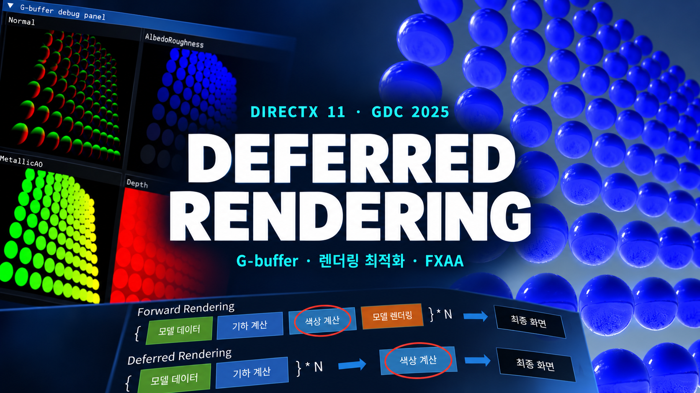
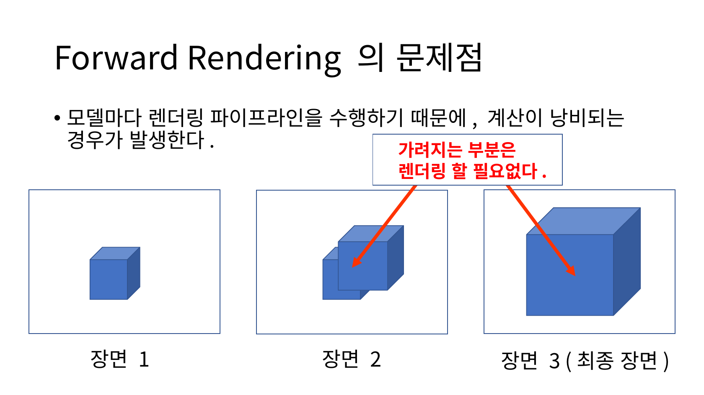
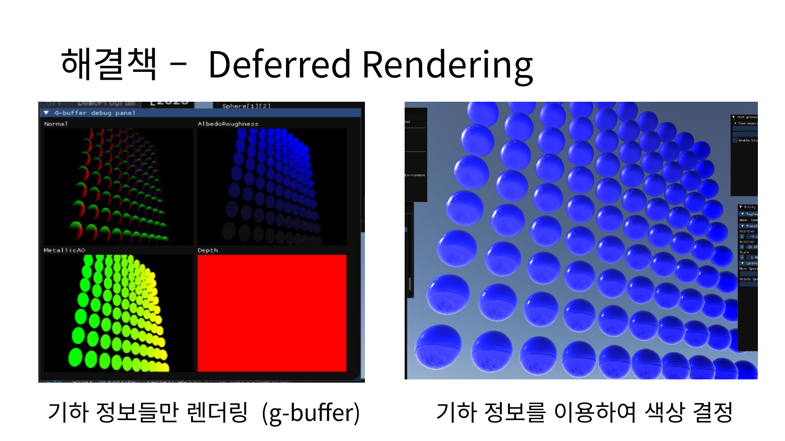
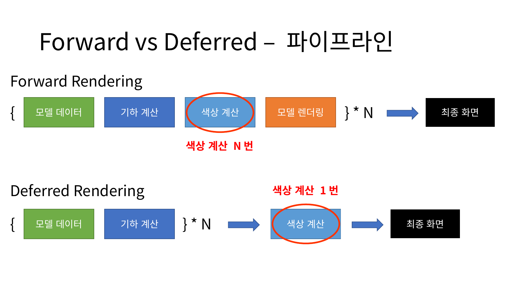
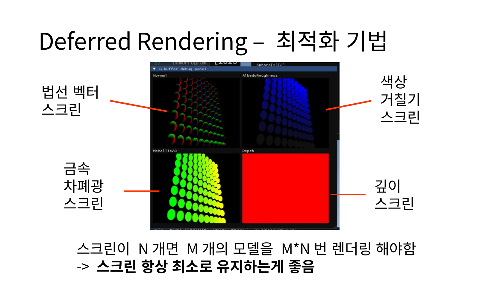
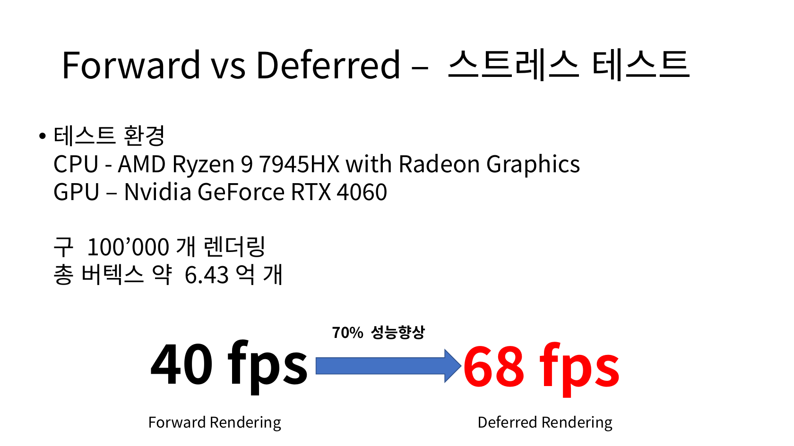
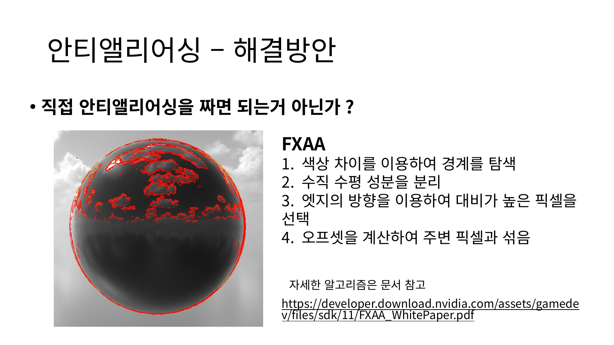

# Deferred Rendering을 이용한 렌더링 최적화

부경대학교 프로그래밍 동아리 GDC에서 Deferred Rendering을 주제로 발표한 자료입니다. 전통적인 Forward Rendering에서 계산이 낭비되는 지점을 짚고, 이를 Deferred Rendering으로 줄이는 방법을 DirectX 11로 직접 구현한 렌더러에서 확인했습니다.

발표는 Forward Rendering의 한계에서 시작해 Deferred Rendering의 2단계 구조와 G-buffer 구성 방법을 설명하고, 같은 장면에서 두 방식을 비교한 성능 측정으로 이어집니다. 마지막으로 Deferred Rendering에서 생기는 안티앨리어싱과 반투명 물체 처리 문제를 해결 방안과 함께 다뤘습니다. 아래에는 각 주제의 내용을 실제 발표 슬라이드와 함께 소개했습니다.

## Contents

- [Forward Rendering의 한계](#forward-rendering의-한계)
- [Deferred Rendering](#deferred-rendering)
- [G-buffer 구성](#g-buffer-구성)
- [성능 비교](#성능-비교)
- [안티앨리어싱](#안티앨리어싱)
- [반투명 물체 처리](#반투명-물체-처리)
- [발표 자료](#발표-자료)

## Forward Rendering의 한계

3D 물체를 그리려면 픽셀마다 위치와 색을 정해야 하고, 색을 정하려면 빛과 법선 벡터, 재질 정보가 필요합니다. 발표에서는 거칠기(Roughness), 금속성(Metallic), 발광(Emission) 같은 재질 값을 빛 반사 수식에 섞어 사용하는 방식을 소개하고, 이 계산을 모든 픽셀에 적용해야 한다는 점을 강조했습니다. 1280×720 해상도에서 60fps로 실행하면 초당 최소 55,296,000번 수식을 계산하게 됩니다.

Forward Rendering은 모델마다 위치 변환, 픽셀 색상 계산, 깊이 테스트와 블렌딩으로 이어지는 렌더링 파이프라인을 한 번씩 수행합니다. 이 중 색상을 계산하는 픽셀 셰이더가 렌더링 시간의 대부분을 차지합니다. 문제는 모델을 하나씩 그리는 동안, 나중에 다른 모델에 가려질 픽셀의 색상까지 모두 계산한다는 점입니다.

*발표 자료 17쪽 — 앞서 계산한 픽셀이 다음 모델에 가려지는 과정*

슬라이드의 세 장면은 모델이 차례로 그려지는 순서를 나타냅니다. 최종 장면에서 보이지 않는 부분도 이전 단계에서 이미 색상 계산을 마쳤기 때문에, 그만큼의 계산이 결과에 반영되지 않고 버려집니다.

## Deferred Rendering

Deferred Rendering은 렌더링을 두 단계로 나눠 이 낭비를 줄입니다. 첫 단계에서는 모든 모델을 그리되 색상은 계산하지 않고, 화면과 같은 크기의 버퍼에 법선, 깊이, 재질처럼 색상 계산에 필요한 기하 정보만 기록합니다. 이 버퍼 묶음을 G-buffer라고 합니다. 두 번째 단계에서는 G-buffer에 최종적으로 남은 정보만 이용해 화면의 각 픽셀 색상을 한 번만 계산합니다.

*발표 자료 19쪽 — G-buffer에 기록한 기하 정보와 이를 이용해 계산한 최종 화면*

*발표 자료 23쪽 — 모델 수만큼 반복되는 범위의 차이*

두 파이프라인 모두 기하 계산은 모델 수인 N번 수행합니다. 차이는 색상 계산의 위치에 있습니다. Forward Rendering은 색상 계산까지 N번 반복하지만, Deferred Rendering은 반복 구간 밖에서 색상을 한 번만 계산합니다. 가려진 픽셀은 G-buffer에 남지 않으므로 무거운 빛과 재질 수식은 실제로 화면에 보이는 픽셀에만 적용됩니다.

## G-buffer 구성

G-buffer는 모든 모델이 기록하는 대상이므로, 버퍼가 늘어날수록 첫 단계의 렌더링 부담도 커집니다. 발표에서는 버퍼 수를 최소로 유지하는 것을 첫 번째 최적화로 꼽았습니다. 구현한 렌더러는 법선, 색상과 거칠기, 금속성과 차폐광, 깊이의 네 가지 버퍼를 사용합니다.

*발표 자료 20쪽 — 직접 구현한 렌더러의 G-buffer 디버그 패널*

색상 계산에는 픽셀의 위치도 필요하지만 위치를 저장하는 버퍼는 따로 두지 않았습니다. 깊이 값으로 구한 정규화 장치 좌표에 투영 행렬과 뷰 행렬의 역행렬을 차례로 곱하고 w 성분으로 나누면 월드 공간의 위치를 복원할 수 있기 때문입니다.

버퍼의 메모리 크기도 줄였습니다. 값의 범위에 맞춰 포맷을 나누고, 게임에서는 32비트 부동소수점만큼의 정밀도가 필요하지 않다는 점을 근거로 16비트 포맷까지만 사용했습니다.

| 값의 범위 | 예시 | 사용한 포맷 |
|---|---|---|
| [0, 1] 사이의 값으로 충분한 경우 | LDR 색상, 금속성, 차폐광, 거칠기 | `DXGI_FORMAT_R8G8B8A8_UNORM` |
| 그 이상의 범위가 필요한 경우 | HDR 색상, 위치, 법선 | `DXGI_FORMAT_R16G16B16A16_FLOAT` |

## 성능 비교

두 방식의 차이를 확인하기 위해 같은 장면을 Forward Rendering과 Deferred Rendering으로 각각 렌더링하는 스트레스 테스트를 진행했습니다. 장면에는 구 100,000개를 배치했고, 전체 버텍스 수는 약 6.43억 개입니다. 측정 환경은 AMD Ryzen 9 7945HX CPU와 NVIDIA GeForce RTX 4060 GPU입니다.

*발표 자료 24쪽 — 구 100,000개 장면의 스트레스 테스트 결과*

Forward Rendering은 40fps, Deferred Rendering은 68fps로, 같은 장면에서 프레임 레이트가 약 70% 향상됐습니다.

## 안티앨리어싱

Deferred Rendering의 첫 번째 한계는 안티앨리어싱입니다. 렌더링은 결국 픽셀을 찍는 작업이라 물체의 경계에 계단 현상이 생기고, 일반적으로는 하드웨어가 지원하는 MSAA로 이를 완화합니다. 그러나 Deferred Rendering에서는 기하 정보를 G-buffer에 저장하는 과정에서 오차가 생기기 때문에 하드웨어 MSAA를 그대로 사용할 수 없습니다.

그래서 화면 단위로 동작하는 FXAA를 렌더러에 직접 적용했습니다. FXAA는 다음 순서로 경계를 찾아 부드럽게 만듭니다.

1. 색상 차이를 이용해 경계를 탐색합니다.
2. 경계의 수직 성분과 수평 성분을 분리합니다.
3. 엣지의 방향을 이용해 대비가 높은 픽셀을 선택합니다.
4. 오프셋을 계산해 주변 픽셀과 섞습니다.

*발표 자료 28쪽 — FXAA가 색상 차이로 찾아낸 경계(빨간색)*

FXAA의 품질은 MSAA보다 조금 떨어지지만, 적용했을 때의 성능 저하는 0.2% 이하로 MSAA보다 빨랐습니다. 발표에서는 이를 좋은 성능으로 만족할 만한 품질을 얻는 방법으로 정리했고, 더 높은 품질이 필요하면 최신 게임에서 많이 쓰는 TAA를 선택할 수 있다는 점도 함께 소개했습니다.

## 반투명 물체 처리

두 번째 한계는 반투명 물체입니다. Deferred Rendering은 모든 물체를 그린 뒤에 색상을 계산하는데, G-buffer에는 가장 앞에 있는 물체의 기하 정보만 남고 그 뒤에 있던 정보는 사라집니다. 따라서 색상을 계산하는 시점에는 뒤쪽 물체가 비쳐 보이는 표현을 할 수 없습니다. 발표에서는 이 문제를 해결하는 세 가지 방법을 조사해 비교했습니다.

| 방법 | 방식 | 장점 | 한계 |
|---|---|---|---|
| 깊이 정렬(z-sort) | Deferred Rendering을 마친 뒤 반투명 물체만 모아 깊이순으로 정렬하고, 먼 것부터 Forward Rendering으로 그림 | 기존 Forward Rendering의 반투명 처리를 그대로 활용 | 매 프레임 정렬 비용이 들고, 객체 단위 정렬이라 반투명 물체끼리 관통하는 장면을 표현하지 못함 |
| 디더링 | 투명한 물체일수록 디더링을 강하게 적용해 반투명을 근사 | Deferred Rendering 안에서 한 번에 처리할 수 있고 성능이 뛰어남 | 진정한 의미의 반투명은 아님 |
| Order-Independent Transparency | GPU 안에 자료구조를 유지해 픽셀마다 각 물체의 기여도를 병합 | 정렬 없이 픽셀 단위로 정확한 투명을 표현 | 성능 저하가 남아 있고 구현이 어려움 |

이 중 디더링은 슈퍼 마리오 오디세이, 세키로 같은 AAA 게임에서도 선택한 방법으로, 그럴듯한 품질과 뛰어난 성능을 함께 얻을 수 있다는 점을 소개했습니다. Order-Independent Transparency는 발표 범위를 넘어서는 주제라 개념과 장단점까지만 다뤘습니다.

## 발표 자료

전체 발표 자료는 37쪽 분량입니다. 렌더링과 빛, 재질에 대한 배경지식부터 Forward Rendering과 Deferred Rendering의 파이프라인 비교, G-buffer 최적화와 스트레스 테스트, 안티앨리어싱과 반투명 물체 처리 방법까지 확인할 수 있습니다.

[발표 자료 PDF 보기](https://github.com/JuggernautSensei/Deferred-Rendering-GDC2025/blob/main/Deferred%20Rendering%EC%9D%84%20%EC%9D%B4%EC%9A%A9%ED%95%9C%20%EB%A0%8C%EB%8D%94%EB%A7%81%20%EC%B5%9C%EC%A0%81%ED%99%94.pdf)
